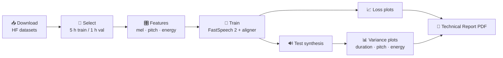

<div align="center">

# 🎙️ FastSpeech 2 — English & Telugu Text-to-Speech

**Two independently trained FastSpeech 2 models, one fully automated pipeline — from raw dataset to deployed web studio.**

[](#-quick-start)
[](https://arxiv.org/abs/2006.04558)
[](#-web-studio--api)
[](docs/DEPLOYMENT.md)
[](docs/DEPLOYMENT.md)
[](#-testing)

[Quick start](#-quick-start) •
[Pipeline](#-how-the-pipeline-works) •
[Requirements map](#-assignment-requirements--where-to-find-them) •
[Web studio](#-web-studio--api) •
[Checkpoints](#-checkpoints) •
[Troubleshooting](#-troubleshooting)

</div>

---

## ✨ Overview

This project delivers two independently trained [FastSpeech 2](https://arxiv.org/abs/2006.04558) models:

- 🇬🇧 **English** — trained on [Svarah](https://huggingface.co/datasets/ai4bharat/Svarah) (Indian-accented English)
- 🇮🇳 **Telugu** — trained on [IndicTTS Telugu](https://huggingface.co/datasets/SPRINGLab/IndicTTS_Telugu)

Both are built on [ming024/FastSpeech2](https://github.com/ming024/FastSpeech2) and ship with an end-to-end automated pipeline, an auto-generated technical report, and a light-themed web studio ready for deployment.

| Component | Details |
|---|---|
| 🧠 **Model** | FastSpeech 2 — 4-layer FFT encoder, variance adaptor, 6-layer decoder, PostNet — paired with a universal HiFi-GAN vocoder |
| 🔗 **Alignment** | Learned and MFA-free (RAD-TTS: CTC forward-sum + Monotonic Alignment Search) |
| 🔤 **Text front-end** | **English:** normaliser + `g2p_en` with POS-aware homographs · **Telugu:** rule-based akshara G2P + Telugu number normaliser |
| 📊 **Data** | ~5 h train / ~1 h validation per language — deterministic, speaker-stratified, text-disjoint |
| ⚙️ **Automation** | `make all` → download → select → features → train → loss plots → test synthesis → variance plots → PDF report |
| 🚀 **Deployment** | FastAPI + web UI, Docker, Docker Compose, Hugging Face Spaces |
| ✅ **Tests** | Unit tests + end-to-end smoke test (synthetic data, CPU, ~2 min) in CI |

> [!IMPORTANT]
> **Status of trained artefacts.** The code, configs and automation are complete and tested end to end.
> Trained checkpoints, generated audio, loss/variance plots and the final PDF are *produced by running
> the pipeline* on a GPU (see [Quick start](#-quick-start)). Until then, `Results/` and `*/checkpoints/` remain empty.

---

## 🚀 Quick start

Get from a fresh clone to a running web studio in five commands:

```bash
git clone <your-repo-url> fastspeech2 && cd fastspeech2
python -m venv .venv && source .venv/bin/activate        # Windows: .venv\Scripts\activate
pip install -r requirements.txt                           # CUDA PyTorch: see pytorch.org first
python scripts/download_assets.py                         # HiFi-GAN vocoder + NLTK data

# Svarah is gated: accept its terms on Hugging Face, then
export HF_TOKEN=hf_xxxxxxxxxxxxxxxx

make all            # == bash scripts/run_all.sh  (both languages, end to end)
make serve          # web studio on http://localhost:7860
```

> [!TIP]
> **No local GPU?** Open [`notebooks/Train_on_Colab.ipynb`](notebooks/Train_on_Colab.ipynb). It keeps
> everything on Google Drive and resumes automatically after a disconnect.

<details>
<summary><b>🔧 Prefer to run each stage yourself? Click for the step-by-step workflow</b></summary>

<br>

```bash
python Telugu/preprocess.py      # download, select 5 h / 1 h, extract mel / pitch / energy
python Telugu/train.py           # train (resumes from checkpoints/last.pt) + training/validation loss plots
python Telugu/inference.py       # 5 test sentences -> audio + duration/pitch/energy plots
python Telugu/inference.py --text "మీకు స్వాగతం" --name welcome --duration 1.1 --pitch 1.05

# Repeat the same steps for English/

python -m fastspeech2.cli report --config English/config.yaml   # Report/Technical_Report.pdf (+ .md)
```

Every config value can be overridden from the command line:

```bash
python English/train.py --set train.total_steps=60000 --set train.max_frames_per_batch=8000
```

</details>

### ⏱️ Expected compute

| Stage | Hardware | Approx. time |
|---|---|---|
| Download + selection + features | CPU (4 cores) | 15–30 min per language |
| Training, 40k steps | T4 / L4 16 GB | ~3–5 h per language (check `sec_per_step` in `logs/<lang>/train_log.csv`) |
| Inference | CPU | ~0.3–1.5 s per sentence |

> [!NOTE]
> **Out of memory?** Lower `train.max_frames_per_batch` (e.g. `8000`).
> **Short on time?** Run `STEPS=20000 make all` — FastSpeech 2 is usually intelligible after ~20k steps on 5 h of data.

---

## 🔄 How the pipeline works

A single `make all` drives every stage below, for both languages:



<details>
<summary><b>🎯 Data selection strategy (both languages)</b></summary>

<br>

1. **Metadata pass** over the whole split — text, gender/speaker, duration.
2. **Filter** to 1–15 s clips whose text passes a script check; relax the 15 s limit only if needed.
3. **De-duplicate** on normalised text, so no prompt appears in both splits.
4. **Speakers:** Telugu keeps one speaker (female preferred) when it alone covers 6 h, otherwise both. English keeps all Svarah speakers (~5 min each) and learns a speaker embedding.
5. **Validation (1 h)** is drawn first, round-robin across speakers; **training (5 h)** comes from the remainder.
6. **Audio processing:** decode → 22.05 kHz → trim silence → peak-normalise → 16-bit WAV + `manifest.jsonl`.

The full selection log is written to `data/<lang>/raw/selection_report.json`.

</details>

<details>
<summary><b>📝 Test sentences</b></summary>

<br>

`data/test_sentences.json` holds **E1–E4** and **T1–T4** exactly as given. The Telugu lines were re-typed
because PDF text extraction breaks Telugu conjuncts. The intentional split *అడ విలో* (T3, mirroring
E3 *rhyth m*) is preserved.

> [!WARNING]
> Check the test sentences against the assignment PDF before submitting.

</details>

<details>
<summary><b>📄 Report workflow</b></summary>

<br>

The report is regenerated from real artefacts every time you run `make report`. It covers:

- Dataset statistics and configurations
- Loss-curve diagnostics — convergence step, spikes, over-fitting check, generalisation gap
- Per-sentence variance analysis — per-word durations, F0, energy, declination, pause lengths, homograph stress for E2

Only *you* can listen to the audio, so record what you hear in `Report/observations.yaml` and rebuild.
Sections still marked `TODO` appear as "pending" in the report.

</details>

---

## ✅ Assignment requirements — where to find them

| Requirement | Location |
|---|---|
| Separate English & Telugu models | `English/config.yaml`, `Telugu/config.yaml` — separate checkpoints, logs and results |
| ~5 h train / ~1 h val, disjoint, documented strategy | `fastspeech2/preprocessor/hf_subset.py` → `data/<lang>/raw/selection_report.json` (asserted + unit-tested) |
| Modified files from the reference implementation | `fastspeech2/` keeps ming024's file names; every file carries a `Modified from …` header; full table in [`docs/MODIFICATIONS.md`](docs/MODIFICATIONS.md) |
| Telugu support | `fastspeech2/text/telugu.py`, `numbers_te.py`, learned aligner |
| Training / validation loss plots | `Results/<Lang>/training_loss.png`, `validation_loss.png` |
| Audio for all test sentences | `Results/<Lang>/test_generated_audios/<ID>.wav` (+ `.json` with all predictions) |
| Duration / pitch / energy plots per sentence | `Results/<Lang>/variance_adaptor_plots/{duration,pitch,energy}/<ID>.png` |
| Technical report | `Report/Technical_Report.pdf`, generated from actual logs and results; listening notes from `Report/observations.yaml` |
| Reproducibility | Fixed seeds, pinned requirements, configs, `make` targets, CI |

---

## 🗂️ Project structure

<details>
<summary><b>Click to expand the full directory tree</b></summary>

<br>

```
project/
├── English/                 train.py · preprocess.py · inference.py · config.yaml · checkpoints/
├── Telugu/                  train.py · preprocess.py · inference.py · config.yaml · checkpoints/
├── Results/<Language>/      training_loss.png · validation_loss.png · test_generated_audios/
│                            variance_adaptor_plots/{duration,pitch,energy,overview}/
├── Report/                  Technical_Report.pdf (generated) · observations.yaml (your listening notes)
├── fastspeech2/             the library — same layout/file names as ming024/FastSpeech2
│   ├── transformer/         Constants.py · SubLayers.py · Layers.py · Models.py
│   ├── model/               fastspeech2.py · modules.py · loss.py · optimizer.py · aligner.py (new)
│   ├── text/                symbols.py · cleaners.py · numbers.py · english.py · telugu.py (new) · numbers_te.py (new)
│   ├── audio/               audio_processing.py (mel / WORLD pitch / energy, HiFi-GAN compatible)
│   ├── preprocessor/        preprocessor.py · hf_subset.py (HF download + 5 h / 1 h selection)
│   ├── hifigan/             models.py · config.json
│   ├── utils/               model.py · tools.py · plots.py · config.py · misc.py
│   ├── dataset.py · train.py · evaluate.py · synthesize.py
│   ├── report/              analysis.py · builder.py (new)
│   └── cli.py               one entry point for every stage
├── app/                     FastAPI server + static web UI (light theme)
├── data/test_sentences.json the assignment's E1–E4 / T1–T4 sentences
├── scripts/                 run_all.sh · download_assets.py · make_synthetic_data.py
├── tests/                   unit tests + end-to-end smoke test
├── notebooks/               Train_on_Colab.ipynb
├── docs/                    MODIFICATIONS.md · DEPLOYMENT.md
├── Dockerfile · docker-compose.yml · Makefile · requirements.txt · pyproject.toml
└── README.md
```

</details>

---

## 🎧 Web studio & API

Launch with `make serve` (or `docker compose up`), then open **http://localhost:7860**.

| Feature | What you can do |
|---|---|
| 🎚️ **Studio** | Type or pick a test sentence, choose a speaker, adjust speed / pitch / energy, then listen and download. Explore the mel spectrogram, interactive duration/pitch/energy charts and per-word phonemes. |
| 📊 **Assignment results** | Browse loss curves, test audios and variance plots straight from `Results/`. |
| 🔌 **REST API** | `POST /api/synthesize` · `POST /api/synthesize.wav` · `GET /api/models` · OpenAPI docs at `/docs` |

<details>
<summary><b>💡 Try the API from your terminal</b></summary>

<br>

```bash
# List available models
curl http://localhost:7860/api/models

# Explore every endpoint and request schema interactively
open http://localhost:7860/docs
```

</details>

Deploying to Hugging Face Spaces, Render or any VM? See [`docs/DEPLOYMENT.md`](docs/DEPLOYMENT.md).

---

## 💾 Checkpoints

Training writes `step_*.pt`, `last.pt` and `best.pt` (weights + optimiser, ~400 MB, git-ignored) and exports
**`model_inference.pt`** — fp16 weights + vocabulary + speakers + statistics + config, ~70 MB. It fits under
GitHub's 100 MB limit and is all the web app needs.

To share full training checkpoints, use Git LFS (`git lfs track "*.pt"`) or upload them to a Hugging Face model repo and link them below:

| Model | Download |
|---|---|
| 🇬🇧 English | `TODO: link` |
| 🇮🇳 Telugu | `TODO: link` |

---

## 🧪 Testing

```bash
pytest -q          # text front-ends, data selection, end-to-end pipeline on synthetic data (CPU)
```

---

## 🛠️ Troubleshooting

<details>
<summary><b>❌ <code>401</code> / <code>GatedRepoError</code> for Svarah</b></summary>

<br>

Accept the dataset terms on Hugging Face, then `export HF_TOKEN=...`.

</details>

<details>
<summary><b>🔲 Telugu shows boxes in plots</b></summary>

<br>

Plots use romanised phone labels on purpose. Telugu script is rendered in the web UI and the Markdown report.

</details>

<details>
<summary><b>🧱 <code>pyworld</code> fails to build</b></summary>

<br>

Run `pip install numpy cython` first, or use Python 3.10 / 3.11 where pre-built wheels exist.

</details>

<details>
<summary><b>🌐 Vocoder download blocked</b></summary>

<br>

The downloader falls back to a sparse `git clone` of the reference repo. If both fail, Griffin-Lim is used instead.

</details>

---

## 📚 References

- Y. Ren et al., *FastSpeech 2: Fast and High-Quality End-to-End Text to Speech*, ICLR 2021.
- ming024/FastSpeech2 — reference PyTorch implementation (MIT).
- R. Badlani et al., *One TTS Alignment To Rule Them All*, ICASSP 2022.
- J. Kong et al., *HiFi-GAN*, NeurIPS 2020.
- T. Javed et al., *Svarah: Evaluating English ASR Systems on Indian Accents*, Interspeech 2023.

---

<div align="center">

**Found this useful?** ⭐ Star the repo, open an issue, or try the web studio with your own sentences.

</div>
